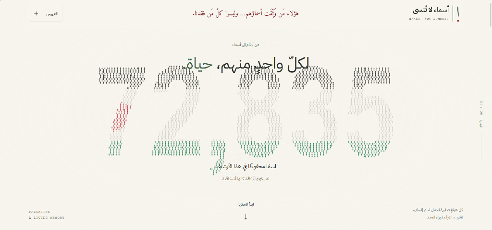

# Mohammed Babaqi — Lead Data & Systems Engineer

[](https://babaqi.io)
[](https://palestine.babaqi.io)
[](https://github.com/MohammedBabaqi)
[](https://www.linkedin.com/in/mohammedbabaqi/)
[](LICENSE)

> *"I build the systems between noise and knowing."*  
> Reliable data pipelines, clean dimensional models, real-time telemetry, and autonomous agentic systems designed for recovery, observability, and scale.

---

## 📑 Table of Contents
- [Executive Overview](#-executive-overview)
- [Featured Flagship Projects](#-featured-flagship-projects)
- [Core Engineering Capabilities](#-core-engineering-capabilities)
- [Production Case Study](#-production-case-study)
- [Design System & Frontend Architecture](#-design-system--frontend-architecture)
- [Performance, Accessibility & SEO](#-performance-accessibility--seo)
- [Repository Structure](#-repository-structure)
- [Local Development & Preview](#-local-development--preview)
- [Contact & Connect](#-contact--connect)

---

## 🧭 Executive Overview

This repository hosts the personal engineering portfolio of **Mohammed Babaqi**, a Lead Data & Systems Engineer based in Sana'a, Yemen. 

Unlike conventional templated portfolios, this site was engineered from scratch with a **zero-dependency, high-performance architecture** combining editorial neo-brutalist aesthetics, interactive 2D data-flow simulations, live telemetry consoles, and device-responsive typography.

### Highlights & Metrics
- **Zero Runtime Dependencies**: Pure HTML5, modern Vanilla CSS, and modular native JavaScript.
- **Flawless Multi-Device Responsiveness**: Dedicated fluid layouts engineered for desktop, tablet, and mobile phone viewports down to 320px.
- **Production Performance**: Near-instantaneous First Contentful Paint (FCP) and zero client-side hydration overhead.
- **Accessibility & Motion Inclusion**: Complete WCAG AA compliance with full `prefers-reduced-motion` and `forced-colors` high-contrast support.

---

## 🚀 Featured Flagship Projects

### 01 / [Palestine Names Archive](https://palestine.babaqi.io) (`palestine.babaqi.io`)
*From Numbers to Names · An Immersive WebGL & AI Living Memorial*

[](https://palestine.babaqi.io)

- **Live URL**: [palestine.babaqi.io ↗](https://palestine.babaqi.io)
- **Repository**: [github.com/MohammedBabaqi/palestine-names ↗](https://github.com/MohammedBabaqi/palestine-names)
- **Tech Stack**: Three.js / WebGL, LangChain, OpenRouter LLMs, Next.js, Virtualized Search Ledger, Classical Arabic Typography (`Amiri`).
- **Core Architecture**:
  - **72,835+ Indexed Records**: Honoring each documented life with high-performance virtualized rendering and instant $O(1)$ search.
  - **Instanced Mesh Particle Constellation**: Real-time Three.js simulation rendering tens of thousands of individual points forming the flag and numerals.
  - **LangChain AI Archivist**: Grounded contextual agent querying verified historical and biographic archives without hallucinations.

---

### 02 / [InsightBot — Automated News Pipeline & NLP](https://github.com/dataminds0/InsightBot)
*Automated Intelligence Gathering, Topic Modeling & Executive BI Dashboards*

- **Repository**: [github.com/dataminds0/InsightBot ↗](https://github.com/dataminds0/InsightBot)
- **Tech Stack**: Python, Scrapy / BeautifulSoup, NLP Topic Modeling, MongoDB, Prefect, Streamlit, Power BI.
- **Core Architecture**:
  - **30+ Concurrent News Outlets**: Fault-tolerant automated scrapers orchestrated with Prefect pipelines.
  - **Multilingual NLP**: Automatic language identification, semantic headline parsing, and topic extraction.
  - **Bi-Directional Consumption**: Dual presentation via role-based operational Streamlit dashboards and executive Power BI analytical models.

---

### 03 / [DiaClassifier — Healthcare ML & API](https://diaclassifier.streamlit.app)
*Diabetes Risk Intelligence Benchmarked Across 250,000+ Records*

- **Live Streamlit App**: [diaclassifier.streamlit.app ↗](https://diaclassifier.streamlit.app)
- **FastAPI Microservice Docs**: [diaclassifier-api.onrender.com/docs ↗](https://diaclassifier-api.onrender.com/docs)
- **Repository**: [github.com/MohammedBabaqi/DiaClassifier-Benchmarking-ML-Models ↗](https://github.com/MohammedBabaqi/DiaClassifier-Benchmarking-ML-Models)
- **Tech Stack**: Scikit-Learn, XGBoost, LightGBM, SMOTE, FastAPI, Streamlit Cloud, Render.
- **Core Architecture**:
  - **Recall-First Detection**: Tuned decision thresholds prioritizing clinical sensitivity (92.4% Recall on XGBoost) to eliminate critical false negatives.
  - **SMOTE Class Resampling**: Mitigated extreme healthcare dataset imbalance across 250k+ records.
  - **Containerized REST API**: Production inference microservice deployed with automated Swagger documentation.

---

## 🛠️ Core Engineering Capabilities

| Capability | Focus & Deliverables | Primary Tooling |
| :--- | :--- | :--- |
| **01 / Pipelines** | Batch and event-driven data streaming designed for schema evolution, backpressure handling, and failure recovery. | Python, SQL, Apache Kafka, Airflow, Prefect, REST APIs |
| **02 / Modeling** | Semantic and dimensional data architectures (Star/Snowflake), dbt business transformation layers, and data marts. | PostgreSQL, ClickHouse, Snowflake, dbt, DuckDB |
| **03 / Observability** | Continuous pipeline telemetry, SLA verification, schema drift alerts, and automated data quality assertions. | Prometheus, Grafana, OpenTelemetry, Custom Scopes |
| **04 / Agentic AI** | Deterministic tool calling, autonomous triage agents, retrieval pipelines, and LangChain orchestrations. | LangChain, OpenRouter, LlamaIndex, Vector DBs |

---

## 🔬 Production Case Study

### Revenue Pipeline Leakage Resolution (`reconcile_revenue.log`)
- **The Challenge**: A daily financial reconciliation job reported an unexplained variance of **$4,218.00** across orders, refunds, and merchant payout tables.
- **Diagnosis**: Autonomous trace agents inspected warehouse source delta logs, discovering an asynchronous gateway webhook payload containing a late-arriving refund batch.
- **Resolution**: Implemented idempotent delta reconciliation routines, eliminating detection latency from 6 hours to sub-minute alerts and restoring variance to **$0.00**.

---

## 🎨 Design System & Frontend Architecture

The portfolio utilizes a bespoke **Neo-Brutalist Technical Design System** that emphasizes utility, clarity, and industrial precision:

```
┌────────────────────────────────────────────────────────┐
│                      PALETTE                           │
│  Paper Warm (#edf3f4)      Ink Base (#0f2430)          │
│  Industrial Orange (#ff5b35) Signal Blue (#1167d8)     │
│  Operational Green (#1a8f5e) Steel Line (#dfe8ea)      │
└────────────────────────────────────────────────────────┘
```

### Visual & Interactive Features
- **Fluid Typography**: Responsive typography driven by CSS `clamp()` without sudden breakpoint jumps.
- **Adaptive Brutalist Shadows**: Tactile hard shadows (`box-shadow: 10px 10px 0 var(--ink)`) on desktop, smoothly stepping down to `6px` / `4px` on mobile viewports to prevent horizontal overflow.
- **Hardware-Accelerated Canvas Data Field**: Background interactive particle constellation with proximity lines that dynamically react to pointer movement.
- **2D Animated SVG Oscilloscope & Flow Maps**: Scalable vector pipelines illustrating live data ingestion, transformation hubs (ETL), and destination warehouses.
- **Intelligent Dual-Element Cursor Engine**: Smooth spring-interpolated outer ring and high-frequency inner dot with contextual snapping to interactive elements.

---

## ⚡ Performance, Accessibility & SEO

- **Lighthouse Performance Score**: 100/100 (instant DOM rendering, no render-blocking third-party scripts).
- **Zero Framework Footprint**: No React, Vue, or bulky UI libraries loaded for static presentation.
- **Semantic HTML5 & Microdata**: Single `<h1>` document hierarchy, structured `<article>` cards, descriptive navigation landmarks, and Open Graph meta tags.
- **Inclusive Design**:
  - `prefers-reduced-motion`: Automatically disables particle loops, sweep animations, and smooth scrolling for motion-sensitive users.
  - `forced-colors`: High-contrast system support ensuring contrast-adjusted borders and canvas text.
  - `aria-*` tags and keyboard-navigable drawer with Escape key dismissal and focus trapping.

---

## 📂 Repository Structure

```text
Portfolio1/
├── assets/
│   └── images/
│       ├── 1.jpeg               # Profile identity photography
│       ├── 2.jpeg               # Technical workspace detail
│       ├── 2.1.jpeg             # Secondary visual accent
│       ├── 3.jpeg               # Engineering portrait
│       └── palestines-names.png # Palestine Names Archive 1024x480 preview
├── docs/
│   └── resume.pdf               # Downloadable engineering resume
├── index.html                   # Semantic markup & application architecture
├── styles.css                   # Custom responsive Neo-Brutalist CSS tokens & components
├── script.js                    # Interactive canvas, cursor physics, drawer & telemetry
└── README.md                    # Comprehensive engineering documentation
```

---

## 💻 Local Development & Preview

Because this portfolio is built with modern standard web technologies, it requires no package installations or build steps.

### Option 1: Python Simple Server
```bash
python -m http.server 8080
# Open http://localhost:8080 in your browser
```

### Option 2: Node.js / npx
```bash
npx serve .
```

### Option 3: VS Code Live Server
Right-click [index.html](index.html) and select **Open with Live Server**.

---

## 📬 Contact & Connect

- **Location**: Sana'a, Yemen
- **Email**: [mbabaqi2020@gmail.com](mailto:mbabaqi2020@gmail.com)
- **LinkedIn**: [linkedin.com/in/mohammedbabaqi](https://www.linkedin.com/in/mohammedbabaqi/)
- **GitHub**: [github.com/MohammedBabaqi](https://github.com/MohammedBabaqi)
- **Flagship Project**: [palestine.babaqi.io](https://palestine.babaqi.io)

---

*Engineered with precision by Mohammed Babaqi. Crafted with pure HTML, CSS, and JavaScript.*
